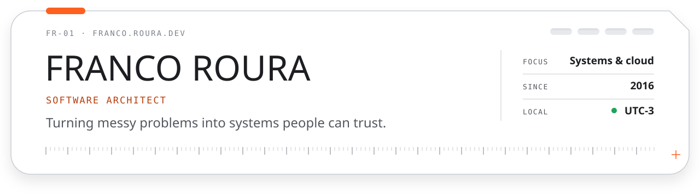

  <a href="https://franco.roura.dev">
    <picture>
      <source media="(prefers-color-scheme: dark)" srcset="./.github/readme/banner-dark.svg">
      <source media="(prefers-color-scheme: light)" srcset="./.github/readme/banner-light.svg">
      
    </picture>
  </a>

## Hi, I'm Franco.

I've spent ten years turning messy problems into systems people can trust, and helping the engineers around me do the same.

These days I'm a software architect at [White Prompt](https://www.whiteprompt.com/). I've worked on the infrastructure and telemetry behind an LLM-powered BI tool, and on a HIPAA-compliant health record platform for mental health care. Before that I spent five years as architect and tech lead at [Capicua](https://www.capicua.com/), and on the AdRoll team I learned what real-time scale feels like when you're processing millions of ad impressions.

Off the clock I take video games apart to see how they tick. Turns out that's most of the job, too.

### What I bring

- **Architecture that fits the problem.** Microservices and event-driven systems designed for availability, cost, and growth, and only as complex as they need to be.
- **Cloud, with the lights on.** AWS first, Azure and GCP when the job calls for it. Terraform, CI/CD, and observability with OpenTelemetry and the Grafana stack, so problems show up on a dashboard before they show up in a support ticket.
- **Teams that enjoy shipping.** Mentoring, code review, and developer experience: the fast feedback loops and sensible defaults that make engineers happier at work.

### How I work

- Simple beats clever.
- I move fast, but I model things properly before they reach production.
- I write tests because future-me deserves kindness. So does whoever's on call.

### Toolkit

**Strongest in:** TypeScript · React · Next.js · Python · AWS · Terraform · SST · Docker · Postgres · Sentry 
**Comfortable with:** C# · Kubernetes · Azure · GCP · MongoDB · Grafana stack 
**Learning for fun:** Go · Rust · DynamoDB

### Say hi

I'm always glad to talk about systems, teams, or whatever you're building. [LinkedIn](https://www.linkedin.com/in/franco-roura/) is the best place to reach me, or take a look around [franco.roura.dev](https://franco.roura.dev). Remote, UTC-3.
